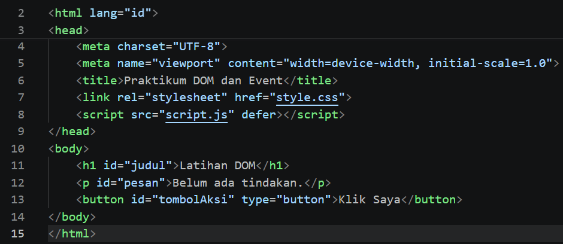
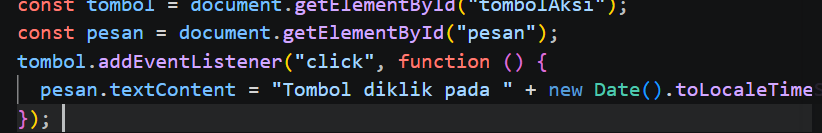
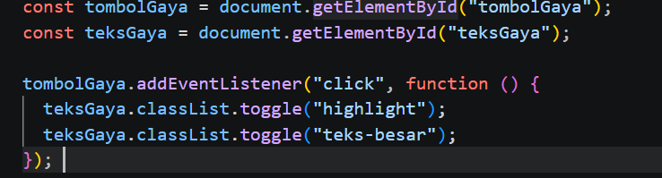
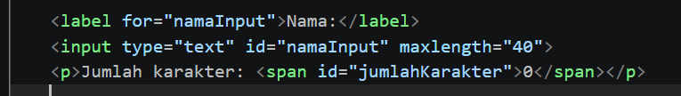
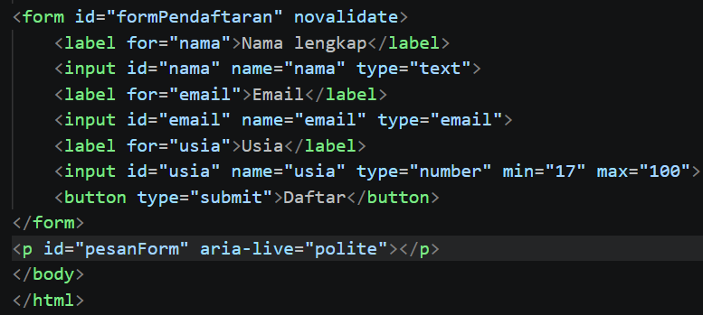
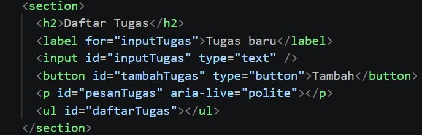
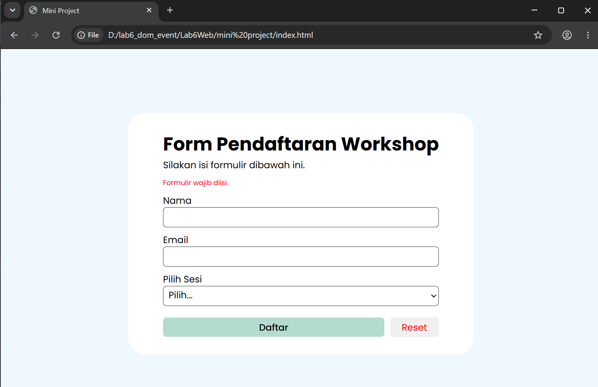

# Praktikum 6: JavaScript DOM dan Event Handling - Lab6Web

Nama : Fuad Muhammad Adfal  
NIM : 312510262  
Kelas : I251A  
Mata Kuliah : Pemrograman Web

## 1. Langkah-Langkah Praktikum & Implementasi

### Latihan 1: Mengubah Teks dengan DOM
Membuat kerangka HTML (`index.html`, `style.css`, `script.js`) dengan atribut `defer` pada tag `<script>`. Elemen dipilih dengan `getElementById()` lalu teks judul dan paragraf diubah memakai `textContent`.

  
  
  

### Latihan 2: Event Click
Menambahkan event `click` pada tombol. Setiap tombol diklik, teks paragraf berubah dan menampilkan waktu saat itu dengan `new Date().toLocaleTimeString()`.

  
  

### Latihan 3: Mengubah Kelas dan Gaya CSS
Membuat class `.highlight` dan `.teks-besar` pada `style.css`. Tombol "Tombol Gaya" memakai `classList.toggle()` untuk menambah atau mencabut kedua class pada paragraf setiap kali diklik.

  
  
  
  

### Latihan 4: Event Input dan Penghitung Karakter
Membuat input nama (maksimal 40 karakter) dengan event `input` yang memperbarui jumlah karakter secara langsung saat pengguna mengetik.

  
  
  

### Latihan 5: Validasi Form Pendaftaran
Membuat form nama, email, dan usia dengan event `submit`. `event.preventDefault()` mencegah halaman dimuat ulang, lalu input diperiksa berurutan: nama, format email (regex), dan usia 17-100. Pesan hasil ditampilkan pada paragraf `#pesanForm`.

Pengujian lima kondisi:

| Kondisi | Hasil |
|---------|-------|
| Semua input kosong | "Nama wajib diisi." |
| Nama terisi, email kosong | "Masukkan email yang valid." |
| Email salah format (`raihandika#gmail.com`) | "Masukkan email yang valid." |
| Nama dan email valid, usia kosong | "Usia harus berupa bilangan bulat 17–100." |
| Semua input valid | "Validasi berhasil. Form siap diproses." |

  
  
  
  
  
  
  
  

### Latihan 6: Daftar Tugas Sederhana (To-do List)
Membuat aplikasi daftar tugas. Elemen `<li>`, ``, dan `<button>` dibuat dengan `createElement()`, lalu ditambahkan ke `<ul>` dengan `append()` dan `appendChild()`. Tombol "Tandai selesai" memberi class `selesai` (teks dicoret) dan mengubah teks tombolnya. Teks tugas dimasukkan lewat `textContent`, sehingga aman dari injeksi HTML.

  
  
  
  
  

## 2. Mini Project: Form Pendaftaran Workshop

Halaman pendaftaran workshop yang dipisahkan ke `index.html`, `style.css`, dan `script.js` di folder `mini_project/`, dengan tampilan responsif untuk desktop dan mobile (gambar disembunyikan pada layar ≤ 1095px, dan layout menyesuaikan pada layar ≤ 588px).

Fitur interaktif yang dibuat:
1. **Validasi form (event `submit`)**: memeriksa nama, email, dan pilihan sesi. Pesan kesalahan tampil di atas form, sedangkan jika valid muncul alert "Validasi berhasil" lalu form di-reset.
2. **Penghitung karakter (event `input`)**: jumlah karakter nama dan email tampil di samping label saat pengguna mengetik, dan disembunyikan bila kolom kosong.
3. **Ringkasan pilihan sesi (event `change`)**: teks "Sesi dipilih" muncul dan berubah mengikuti pilihan dropdown.
4. **Tombol Reset (event `click`)**: mengosongkan seluruh input beserta penghitung karakternya.

Pengujian validasi dan fitur interaktif:

| Kondisi | Hasil |
|---------|-------|
| Semua kosong | "Formulir wajib diisi." |
| Nama terisi, email salah format | "Masukkan email yang valid." (penghitung karakter nama dan email aktif) |
| Nama dan email valid, sesi belum dipilih | "Sesi harus dipilih." |
| Memilih sesi pada dropdown | Muncul teks "Sesi dipilih: ..." |
| Semua input valid | Alert "Validasi berhasil" |

Tampilan desktop:

  
  
  
  
  

